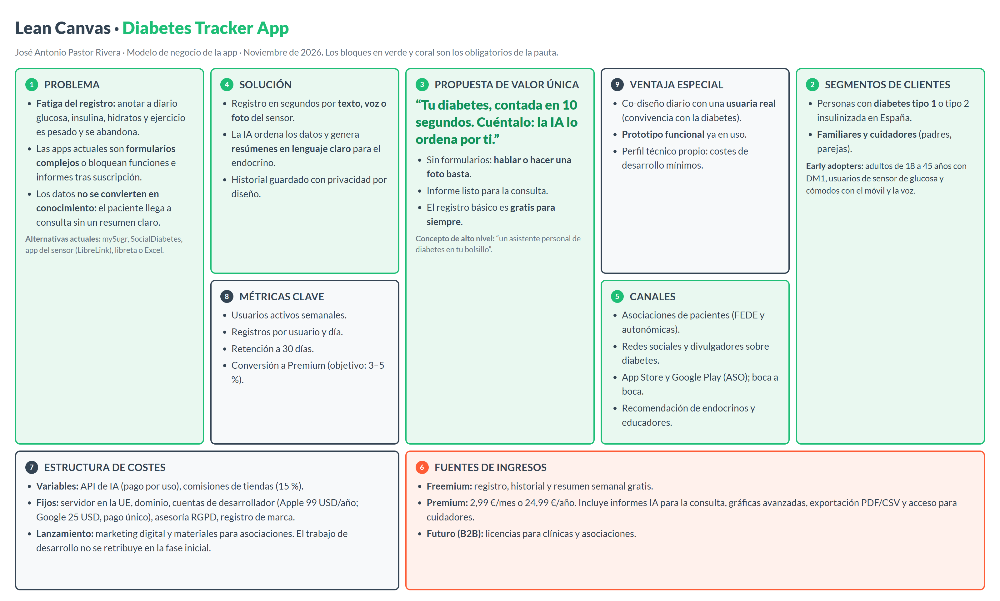

# Modelo de negocio

Resumen del modelo de negocio de Diabetes Tracker App: lo justo para entender por qué la app se construye así. El estudio completo (mercado, competencia, marketing y presupuesto) está en la memoria del proyecto emprendedor de IPE II.

## Propuesta de valor

**«Tu diabetes, contada en 10 segundos.»** Cuéntalo y la IA lo ordena por ti.

El problema que resuelve es la **fatiga del registro**: anotar cada día glucosa, insulina, hidratos y ejercicio es pesado y se acaba abandonando. Las apps actuales compiten en profundidad clínica (más campos, calculadoras); esta compite en **rapidez y facilidad**, en español y con el registro básico gratis.

## Para quién

- **Principal:** adultos de 18 a 45 años con diabetes tipo 1 (o tipo 2 con insulina) en España, que usan sensor de glucosa y se manejan con el móvil y la voz.
- **Secundario:** familiares y cuidadores (por ejemplo, un padre con un hijo con diabetes tipo 1). Son los que más valoran el modo cuidador.

## Cómo se financia

| Concepto | Valor | Origen |
|---|---|---|
| Premium | 2,99 €/mes o 24,99 €/año (IVA incluido) | Un 40 % por debajo de mySugr Pro (4,99 €/mes en la App Store española) |
| Margen por usuario Premium | 1,90 €/mes (mensual) · 1,26 €/mes (anual) | Precio sin IVA − comisión de la tienda (15 %) − IA (≈ 0,20 €) * |
| Costes fijos | ≈ 70 €/mes | Servidor, cuentas de desarrollador, dominio y asesoría * |
| Punto de equilibrio | ≈ **45 usuarios Premium** | 70 € ÷ 1,58 € de margen medio * |
| Conversión esperada | 3–5 % de los usuarios gratuitos | Hacen falta entre 900 y 1.500 usuarios activos |

\* Estimación o cálculo propio.

## Qué implica para el desarrollo

- **El coste de la IA manda.** Solo se llama a Gemini cuando hay un registro nuevo, con un modelo ligero; por eso el prompt pide una salida estructurada y corta (D6).
- **No depender de un proveedor.** La interfaz `Extractor` (D5) permite cambiar de IA si sube el precio.
- **La propuesta de valor se mide.** El registro tiene que durar menos de 15 segundos (ver `docs/producto.md`), y es la primera métrica del piloto.
- **Lo que se cobra es lo que diferencia:** informe para el endocrino, cuidadores, exportación y recordatorios. El registro nunca se cobra.
